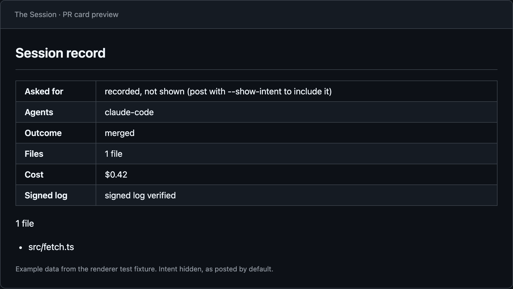

# The Session

**The system of record for agent work.** You declare what an AI coding agent is
about to do; `session` records what it actually changed, how far that went
outside what you declared, whether it landed on the default branch, and what it
cost — signed, append-only, on your own disk.

## Install

```
$ npm i -g @vedantzz/session
```

Node 20 or later, inside any git repository.

## Quick start

**1. Declare what the agent is about to do, and where.** The intent cannot be
edited afterwards.

```
$ session start "add a farewell function next to greet" --scope src
```

Run `session start` with no arguments to answer the two prompts instead: what
you are working on, then expected files or folders, one per line.

**2. Run the agent** the way you normally would.

```
$ claude
```

`session hook install` registers the Claude Code hooks, and writes the same
hooks to `~/.codex/hooks.json` if Codex is installed (approve them with `/hooks`
in the Codex CLI). Without `start`, the hook records the first prompt as the
intent and no scope.

**3. Close the record.** It shows the outcome, what changed, what fell outside
the declared scope, and the turns, tokens and cost read from the transcript.

```
$ session stop
```

**4. Read it back.**

```
$ session week               # the last 7 days
$ session week last          # the latest session
$ session week <id> --full   # every path and counter for one session
```

`session --help` shows the short list; `session help all` lists every command.

## Breaking in 3.0

`session ui` is removed. Use `session week` for history and
`session week <id> --full` for details.

## PR card

One comment on each pull request, updated on every push, saying what the
record holds for its commits. Records come from `session push`.



| | |
|---|---|
| `session pr --card` | Print the card for a commit range as Markdown. |
| `session pr --json` | Print the card's data as JSON. |
| `session pr --post` | Post the card as the PR's one card comment, updating it in place. Reads `GITHUB_TOKEN` and `GITHUB_REPOSITORY`; `--pr <number>` names the PR. |

`--base <ref>` and `--head <ref>` set the range; the defaults are the merge base
with the default branch and `HEAD`. A posted card leaves the recorded intent
off unless you add `--show-intent`. `--card` and `--json` print locally and
include it.

The GitHub Action posts the card for you:

```yaml
on: pull_request
permissions:
  contents: read
  pull-requests: write
  issues: write
jobs:
  card:
    runs-on: ubuntu-latest
    steps:
      - uses: actions/checkout@v4
        with:
          fetch-depth: 0
      - uses: vedntzz/The-Session@v3
```

`pull-requests: write` and `issues: write` let it post the comment; the full
history lets it read the PR's commits. Intent text is included only when the
`show-intent` input is `"true"`. Fork pull requests are skipped, since their
token cannot write.

`session pr [id]` without a card flag writes a pull request body from one
session's record; pipe it into `gh pr create --body-file -`.

## Team report

```
$ session team --html
```

Writes a self-contained page from every synced session record, to
`./session-team.html` or to `--out <path>`. It covers this repo only and says
how many sessions from other repos it left out. `--since` takes `7d`, `30d` or
`90d`; the default is `30d`. Records from teammates arrive with `session pull`.


## How it measures

- **Each API call is counted once.** A transcript writes one call as several
  streaming fragments sharing a `requestId`; the first is counted and the rest
  are dropped.
- **Four token counters, never summed.** Input, output, cache reads and cache
  writes bill at different rates, so each is priced at its own rate.
- **Unpriced is never `$0.00`.** A model with no rate is named and its cost reads
  `unknown`. A measured zero reads `$0.00`.
- **Merges match file content, not commits.** `stop` records the blob of each
  file the session left; merged means those bytes reached that path on the
  default branch after the session began. This survives squash, rebase and
  cherry-pick.
- **Signed hash chain.** Every record is one line in an append-only JSONL log,
  chained by hash and signed with an Ed25519 key made on this machine.
  `session verify` checks it; `session key show` prints the public key so anyone
  can check the log without your machine.
- **Local first.** Records live under `~/.session/`. No account, no server, no
  telemetry. They leave the machine only when you run `session push`, onto a
  git remote you already have, on refs of their own. Source code and
  transcripts are never in them; the one text you wrote that is, is the intent
  — or, for a session the hook opened, your first prompt.
- **No model judges the work.** Diffs, exit codes and transcript token counts
  only.

## Checking writes against terms

Add `--review` to `start` to accept terms as well: paths, actions (`create`,
`edit`, `delete`), sensitive paths, and a policy — `record`, `ask` or `deny`.
`session hook install --repo` registers `session hook check` in this
repository's `.claude/settings.local.json` only. Before each write it answers
`ask` or `deny` when the write falls outside the terms, and says nothing
otherwise. It never grants a permission. See [Agreements](docs/agreements.md).

## Other commands

| | |
|---|---|
| `session prime "<intent>"` | Suggest scope paths your past planning missed; `--debt` shows what keeps drifting. [Prime](docs/prime.md) |
| `session survival` | How much merged work is still there at 14 and 30 days. |
| `session agents` | Each coding agent's sessions: writes checked, merged, survived 30 days, cost. |
| `session scan` | What agent sessions already on this machine have cost — no setup needed. |
| `session knowledge` | A local graph of which sessions touched which paths. [Knowledge](docs/knowledge.md) |
| `session verify` | Check the log's hash chain and signatures. |

## Known limitations

- A session that only deletes files is not matched to a PR.
- Reverts are not detected: work reverted after it merged still reads as merged.
- Abandoned work nobody marks with `session mark` counts as still open, so the
  "never merged" figure stays low.
- The log lock has a narrow race between two writers.
- The bundled rates carry one checked date for the whole table, not one per
  model.

---

[Design decisions](docs/decisions.md) · [Practices](PRACTICES.md) · [Changelog](CHANGELOG.md) · [MIT](LICENSE) · [Issues](https://github.com/vedntzz/The-Session/issues)
